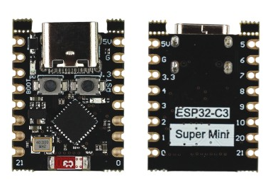

# ESP32-C3 Super Mini

Pasta de referência e projetos de robótica com a placa **ESP32-C3 Super Mini** (USB-C).

## Visão geral

Placa IoT compacta com CPU **RISC-V 32-bit** (ESP32-C3), **Wi‑Fi 2.4 GHz** e **Bluetooth 5 (LE)**. Adequada para sensores, wearables, controles sem fio e protótipos robóticos leves.

| Item | Valor |
|------|--------|
| Modelo da placa | ESP32-C3 Super Mini |
| Chip (UsinaInfo) | **ESP32-C3FH4** (flash 4 MB no package) |
| Chip (guia incluso) | ESP32-C3FN4 — variante antiga / EOL no datasheet Espressif |
| CPU | RISC-V single-core, até **160 MHz** |
| SRAM / ROM / Flash | ~400 KB / 384 KB / **4 MB** |
| GPIOs úteis | **13** (típico Super Mini) |
| ADC | GPIO0–GPIO4 (ADC1); GPIO5 = ADC2 (evitar com Wi‑Fi ativo) |
| LED embarcado | **GPIO8** (azul; na maioria das placas é **active-low**) |
| Botão BOOT | **GPIO9** |
| USB | Type‑C nativo (GPIO18/19, não saem no header) |
| Nível lógico | **3,3 V** (não tolera 5 V nos GPIO) |
| Alimentação | **3,3 V** no pino 3V3 · **5–6 V** no USB ou pino **5V** |
| Corrente típica | ~60 mA (uso normal) |
| Dimensões / peso | ~24 × 18 × 4 mm · ~3 g |
| Acompanha | 2× barra de pinos 1×8 (soldar) |

> Confira o chip gravado na sua placa. O datasheet Espressif marca **ESP32-C3FN4** como *End of Life* e recomenda variantes **FH4X** para projetos novos.

---

## Pinout (USB-C no topo)

Vista frente (esquerda) e verso com silkscreen dos pinos (direita):



Layout das duas fileiras de 8 pinos (USB-C no topo), conforme a imagem:

```
        [ USB-C ]
  5V  ·········  GPIO5
  GND ·········  GPIO6
  3V3 ·········  GPIO7
  GPIO4········· GPIO8   ← LED (e strapping)
  GPIO3········· GPIO9   ← BOOT (strapping)
  GPIO2········· GPIO10
  GPIO1········· GPIO20  ← UART0 RX
  GPIO0········· GPIO21  ← UART0 TX
```

Na face superior: botões **BOOT** e **RST**, cristal **40 MHz** e antena cerâmica na extremidade oposta ao USB.

### Funções úteis

| Pino | Uso principal | Observações |
|------|----------------|-------------|
| 5V | Entrada/alimentação ~5 V | Não usar junto com USB |
| GND | Terra | — |
| 3V3 | Saída regulada 3,3 V | Só sensores/módulos de baixa corrente |
| GPIO0–4 | Digital, PWM, **ADC1** | Melhores opções analógicas |
| GPIO5 | Digital / ADC2 | ADC2 pouco confiável com Wi‑Fi |
| GPIO6–7,10 | Digital / SPI | Bons pinos gerais |
| GPIO8 | LED + default I2C SDA | Strapping; LED costuma acender com `LOW` |
| GPIO9 | BOOT | Strapping; não puxe para GND no boot |
| GPIO2 | Digital / ADC | Também é strapping — cuidado no reset |
| GPIO20 / 21 | UART0 RX / TX | `Serial` USB usa CDC; estes são UART físico |
| GPIO18 / 19 | USB D− / D+ | Só no conector USB‑C |

**I2C / SPI:** no ESP32-C3 o roteamento é flexível (GPIO matrix). Prefira pares sem strapping, por exemplo `Wire.begin(0, 1)` (SDA/SCL), em vez de GPIO8/9.

---

## Cuidados de hardware (robótica)

1. **Nível lógico 3,3 V** — módulos 5 V precisam de conversor de nível; nunca ligue 5 V direto em GPIO.
2. **Motores / servos / relés** — alimentação e drivers **separados** (L298N, DRV8833, TB6612, MOSFET, etc.). Compartilhe só o GND.
3. **USB e 5V externo** — escolha **um** caminho de alimentação. Não ligue USB e fonte no pino 5V ao mesmo tempo.
4. **Corrente no 3V3** — o regulador da placa é fraco; sensores grandes, displays e motores **não** saem do 3V3 da Super Mini.
5. **Strapping (GPIO2, 8, 9)** — evite pull-down externo no power-on/reset; pode impedir o boot.
6. **ADC** — faixa útil típica até ~**2,5 V** (não toda a faixa 0–3,3 V). Use divisor resistivo se necessário.
7. **Cabo USB‑C** — use cabo **com dados** (alguns só alimentam).
8. **Antena** — cerâmica integrada; não cubra com metal/PCB se o Wi‑Fi/BLE for crítico.

---

## Setup — Arduino IDE (início rápido)

Baseado no [guia UsinaInfo](https://www.usinainfo.com.br/esp32/esp32-c3-super-mini-com-wifi-e-bluetooth-com-usb-c-8967.html) e no *Guia Básico Internacional* desta pasta.

1. Instale a [Arduino IDE](https://www.arduino.cc/en/software).
2. **Arquivo → Preferências → URLs Adicionais**:
   ```
   https://raw.githubusercontent.com/espressif/arduino-esp32/gh-pages/package_esp32_index.json
   ```
3. **Ferramentas → Placa → Boards Manager** → busque `esp32` → instale o pacote Espressif.
4. Selecione:
   - **Placa:** `ESP32C3 Dev Module`
   - **USB CDC On Boot:** `Enabled` (necessário para `Serial.print` via USB)
   - **Porta:** a COM da Super Mini
5. Upload de teste (LED GPIO8 — active-low na maioria das placas):

```cpp
const int LED = 8;

void setup() {
  pinMode(LED, OUTPUT);
}

void loop() {
  digitalWrite(LED, LOW);   // acende (active-low)
  delay(500);
  digitalWrite(LED, HIGH);  // apaga
  delay(500);
}
```

### Problemas comuns

| Sintoma | Solução |
|---------|---------|
| Porta COM não aparece | Segure **BOOT** ao conectar o USB; use cabo com dados |
| Erro no upload | Segure **BOOT**, toque **RST**, solte **BOOT** (modo download) |
| Código sobe mas não roda | Pressione **RST** após o upload |
| Serial sem texto | **USB CDC On Boot → Enabled** |

---

## Setup — ESP-IDF (oficial Espressif)

Para projetos mais avançados (controle fino de Wi‑Fi/BLE, low power, produção), use o **ESP-IDF**.

Documentação: [Get Started — ESP32-C3](https://docs.espressif.com/projects/esp-idf/en/latest/esp32c3/get-started/index.html)

### O que você precisa

- Placa ESP32-C3 (esta Super Mini serve)
- Cabo USB correto (Type‑C na Super Mini)
- PC Windows / Linux / macOS
- **Toolchain** + **CMake/Ninja** + **ESP-IDF** (API e scripts)

### Fluxo

1. **Instalação** — use o [ESP-IDF Installation Manager (EIM)](https://docs.espressif.com/projects/esp-idf/en/latest/esp32c3/get-started/index.html) (GUI ou CLI).
2. **Desenvolvimento** — criar → configurar (`menuconfig`) → build → flash → monitor.
3. **IDE opcional**
   - [Espressif-IDE](https://github.com/espressif/espressif-ide) (Eclipse)
   - Extensão **ESP-IDF** no VS Code / Cursor

> Prefira a documentação da versão **stable** do ESP-IDF em produção; a página *latest* acompanha o branch em desenvolvimento contínuo.

### Arduino vs ESP-IDF (escolha rápida)

| | Arduino | ESP-IDF |
|--|---------|---------|
| Curva de aprendizado | Mais fácil | Mais íngreme |
| Prototipagem | Rápida | Mais setup |
| Controle / produção | Limitado | Completo |
| Robótica hobby | Ideal para começar | Ideal para evoluir |

---

## Documentos nesta pasta

| Arquivo | Conteúdo |
|---------|----------|
| `esp32-c3_datasheet_en.pdf` | Datasheet oficial Espressif ESP32-C3 Series v1.8 (chip) |
| `Guia Básico Internacional.pdf` | Tutorial Arduino / Wi‑Fi / BLE da placa Super Mini |
| `esp32-c3-super-mini-pinout.png` | Foto frente/verso com pinout silkscreen |
| `README.md` | Este resumo operacional |

---

## Referências

- [UsinaInfo — ESP32-C3 Super Mini WiFi Bluetooth USB-C](https://www.usinainfo.com.br/esp32/esp32-c3-super-mini-com-wifi-e-bluetooth-com-usb-c-8967.html)
- [ESP-IDF Get Started (ESP32-C3)](https://docs.espressif.com/projects/esp-idf/en/latest/esp32c3/get-started/index.html)
- [Datasheet ESP32-C3 (Espressif)](https://www.espressif.com/documentation/esp32-c3_datasheet_en.pdf)
- Pinout consolidado (referência comunitária): [NuttX ESP32-C3 SuperMini](https://nuttx.apache.org/docs/latest/platforms/risc-v/esp32c3/boards/esp32c3-supermini/index.html)

---

## Projetos

| Pasta | Descrição |
|-------|-----------|
| [`projetos/carrinho_smars/`](projetos/carrinho_smars/) | Carrinho **SMARS** ([Thingiverse 1582398](https://www.thingiverse.com/thing:1582398)) adaptado ao ESP32-C3 Super Mini |

## Próximos passos sugeridos

1. Soldar as barras de pinos e validar o blink no GPIO8.
2. Seguir o checklist em `projetos/carrinho_smars/README.md`.
3. Testar Wi‑Fi/BLE depois da base de motores e sensores.
