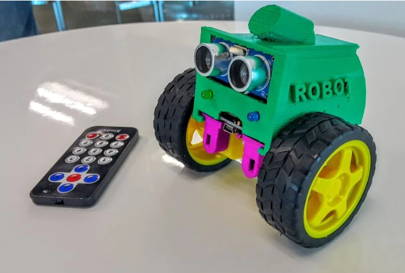

# Carrinho SMARS + ESP32-C3 Super Mini

Projeto de adaptação do robô modular **SMARS** para o **ESP32-C3 Super Mini** (USB-C), com Wi‑Fi/BLE e hardware da sua montagem atual.



## Origem do modelo 3D

| | |
|--|--|
| Nome | **SMARS** — Screwless/Screwed Modular Assembleable Robotic System |
| Autor | Kevin Thomas |
| Thingiverse | [thing:1582398](https://www.thingiverse.com/thing:1582398) |
| Ideia | Robô educacional barato, poucas peças, montagem sem solda/parafusos (versão SL), design modular para sensores/ferramentas |

Referências extras: [O que é SMARS](https://www.smarsfan.com/about/what_is_smars) · [MyMiniFactory / SMARS](https://www.myminifactory.com/object/3d-print-50346)

### Bill of materials clássico (SMARS original)

- Chassis impresso (chassis-SL ou chassis-S)
- 2× motores mini ~150 RPM + rodas/esteiras
- Arduino UNO + Adafruit Motor Shield (V1/V2) **← será substituído**
- Bateria 9 V (ou variantes AAA / Li-Ion com cuidado)
- Módulos opcionais: ultrassom, IR, pá, etc.

---

## Sua montagem (foto de referência)

Identificado na imagem:

| Item | Observação |
|------|------------|
| Chassis | Impressão 3D verde/rosa, lateral **ROBO** (variante SMARS / remix) |
| Tração | 2 rodas amarelas + pneus pretos (diferencial) |
| Sensor | **HC-SR04** na frente |
| LEDs | Verde e azul no painel frontal |
| Controle | Controle IR **Xinda** (implica receptor IR na placa) |
| USB atual | Micro‑USB visível → placa antiga (ex.: Pro Micro / clone Arduino) |

**Meta desta pasta:** trocar o MCU atual pelo **ESP32-C3 Super Mini**, mantendo chassis/motores/sensores e adaptando suporte + pinagem + firmware.

---

## Estrutura do projeto

```
carrinho_smars/
├── README.md                 ← este arquivo
├── docs/
│   └── referencia_robo_atual.png
├── mecanica/                 ← STLs originais + peças adaptadas
│   └── ADAPTACOES.md
├── eletrica/                 ← diagrama e pinout ESP32-C3
│   └── PINOUT.md
└── firmware/                 ← sketches / PlatformIO
    └── README.md
```

---

## Adaptação: Arduino/UNO → ESP32-C3 Super Mini

| Aspecto | SMARS clássico | Este projeto |
|---------|----------------|--------------|
| MCU | Arduino UNO / Pro Micro | **ESP32-C3 Super Mini** |
| USB | USB‑B / Micro‑USB | **USB‑C** |
| Motor shield | Adafruit Motor Shield | Driver DC (ex.: **DRV8833** / TB6612 / L298N) |
| Nível lógico | 5 V | **3,3 V** (nível lógico / HC-SR04 VCC pode ser 5 V com cuidado no Echo) |
| Controle | IR / cabo | IR + futuro **Wi‑Fi / BLE** |
| Alimentação | 9 V típico | Bateria + regulador; **não** alimentar motores pelo 3V3 da Super Mini |

### Peças 3D a adaptar (prioridade)

1. **Suporte / holding board** do MCU — furo e vão do USB‑C da Super Mini (~22–24 × 18 mm).
2. Passagem do cabo USB‑C (frente ou lateral), se quiser programar sem desmontar.
3. Fixação do driver de motor (mais fino que o Motor Shield do UNO).
4. Manter mounts de HC-SR04 e receptor IR se já encaixam.

Detalhes em [`mecanica/ADAPTACOES.md`](mecanica/ADAPTACOES.md).

---

## Eletrônica (resumo)

Ver pinout proposto em [`eletrica/PINOUT.md`](eletrica/PINOUT.md).

Regras obrigatórias (ver também README da Super Mini):

- Motores em **fonte própria** + GND comum com o ESP32.
- Echo do HC-SR04: divisor 5 V → 3,3 V **ou** módulo já 3,3 V.
- Evitar GPIO **2, 8, 9** para cargas/botões que puxem LOW no boot.
- LED embarcado da Super Mini = GPIO8 (active-low).

---

## Firmware (fases)

| Fase | Objetivo |
|------|----------|
| 1 | Blink + Serial USB (CDC) |
| 2 | LEDs frontais + HC-SR04 |
| 3 | Motores (PWM + direção) |
| 4 | Controle IR (códigos do Xinda) |
| 5 | Modo autônomo (evitar obstáculo) |
| 6 | Wi‑Fi / BLE (telemetria ou app) |

Esboço em [`firmware/README.md`](firmware/README.md).

---

## Checklist de desenvolvimento

- [ ] Baixar STLs do [Thingiverse 1582398](https://www.thingiverse.com/thing:1582398) para `mecanica/originais/`
- [ ] Medir vão atual do MCU e desenhar suporte Super Mini
- [ ] Definir driver de motor e tensão da bateria
- [ ] Soldar pinos da Super Mini e validar upload Arduino
- [ ] Ligar HC-SR04 + LEDs (fase 2)
- [ ] Ligar motores com driver (fase 3)
- [ ] Mapear teclas do controle Xinda (fase 4)

---

## Fontes

- [Thingiverse — SMARS (thing:1582398)](https://www.thingiverse.com/thing:1582398)
- [UsinaInfo — ESP32-C3 Super Mini](https://www.usinainfo.com.br/esp32/esp32-c3-super-mini-com-wifi-e-bluetooth-com-usb-c-8967.html)
- [ESP-IDF Get Started — ESP32-C3](https://docs.espressif.com/projects/esp-idf/en/latest/esp32c3/get-started/index.html)
- Documentação da placa: `../../README.md`
